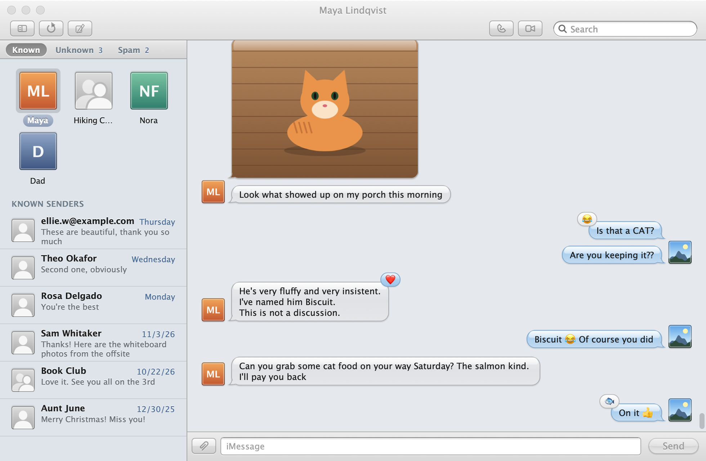

# Lion Messages


A personal macOS Messages client dressed as a Mac OS X Lion (10.7) app: Lucida Grande,
a brushed-gray unified toolbar, a Finder-style source list, glossy iChat bubbles, a sunken
Aqua composer, and a graphite dark mode.

It reads your local Messages database read-only and sends through Messages.app. There is no
server and no analytics. The only network access is optional link previews for links you sent
(see [Network access](#network-access)).




Screenshots show the built-in demo data, not real conversations.

## Features

- Conversation list and message history from `~/Library/Messages/chat.db` (opened read-only)
- Decodes message bodies stored in `attributedBody`
- Contact names and iChat-style buddy pictures from Contacts (View ▸ Show Buddy Pictures)
- Live updates when the database changes
- Sending through Messages.app via AppleScript
- Sending files and pictures: the paperclip button or File ▸ Attach Files… (⇧⌘A), dragging
  files or pictures onto the conversation, or pasting them; pending files wait in a tray above
  the composer and are sent before the text
- Inline images, video thumbnails, file bubbles, clickable links, and link preview cards
  built from the preview data Messages already stored
- Link previews for links you sent that have no stored preview (View ▸ Fetch Missing Link
  Previews, on by default; see [Network access](#network-access))
- Lion-style animations; respects Reduce Motion

## Requirements

- macOS 13 or later (built and tested on macOS 27 with Xcode 27 / Swift 6.4)
- Lucida Grande and Menlo, which ship with macOS

## Build and run

```sh
scripts/build-app.sh          # builds build/Lion Messages.app (release)
open "build/Lion Messages.app"
```

The script signs with your first code-signing identity if you have one, so permission
grants survive rebuilds; otherwise it signs ad hoc.

To try it without touching your messages, run the demo data:

```sh
swift run LionMessages --demo
swift run LionMessages --demo --appearance dark
```

The demo never uses the network: link previews come from a built-in stub.

## Permissions

| Permission | Why | Where |
| --- | --- | --- |
| Full Disk Access | Read `chat.db` and attachments | System Settings ▸ Privacy & Security ▸ Full Disk Access |
| Contacts | Names and pictures instead of phone numbers | Prompted on first launch |
| Automation (Messages) | Send messages | Prompted on first send |

## Network access

Fetching missing link previews is the only time Lion Messages uses the network.

- **When:** only for messages *you* sent that contain an http(s) link and have no preview
  stored by Messages (typically links sent from Lion Messages, since Messages does not build
  previews for messages sent through AppleScript). Links in messages you received are never
  fetched, so opening a spam text does not contact its links.
- **What is contacted:** the linked site itself, through Apple's LinkPresentation framework.
  At most two fetches run at a time, only for the newest
  messages of the conversation you open, and a link that failed is not retried for 24 hours.
- **Cache:** titles, descriptions and downsized pictures are kept in
  `~/Library/Application Support/Lion Messages/LinkPreviews` (entries expire after 30 days;
  the folder is kept under about 100 MB). Cached previews keep showing without the network.
- **Turning it off:** uncheck View ▸ Fetch Missing Link Previews. No requests are made while it
  is off; previews already cached are still shown. Delete the folder above to clear the cache.

## Sending files

Messages.app is sandboxed, and when AppleScript hands it a file from an arbitrary folder (a
temporary folder, the Desktop) the send often fails or never arrives. So before sending,
Lion Messages copies each file to `~/Pictures/Lion Messages Outbox/<random id>/<original name>`,
a place Messages can read, and sends that copy. The copies are not deleted right away (Messages
reads them in the background); copies older than a day are removed the next time the app
starts. Files over 100 MB are refused.

## Tests

```sh
swift test
```

Tests use synthetic databases and never read your messages. An opt-in check against your
real database prints counts and timings only:

```sh
LION_REAL_DB_SMOKE=1 swift test --filter RealDatabaseSmokeTests
```

## Known limits

- The same person can appear as several conversations (SMS, RCS and iMessage chats are not merged)
- Shows the most recent 300 messages per conversation
- No reactions, typing indicators, or read receipts
- Attachments that are not downloaded to this Mac show a placeholder
- Starting a new conversation is not implemented; reply in existing ones
- Drags that only offer a file promise (some apps, such as Photos or Mail) can't be attached;
  drag from Finder, or export the item first

## Layout

- `Sources/MessagesModel` — shared models and the `MessagesService` protocol
- `Sources/MessagesData` — SQLite reader, decoders, Contacts, file watcher, AppleScript sender
- `Sources/LionMessages` — the AppKit/SwiftUI app and the Lion theme
- `scripts/` — app bundling and icon generation

Not affiliated with Apple. "Messages", "iChat" and "Mac OS X Lion" are Apple trademarks.
