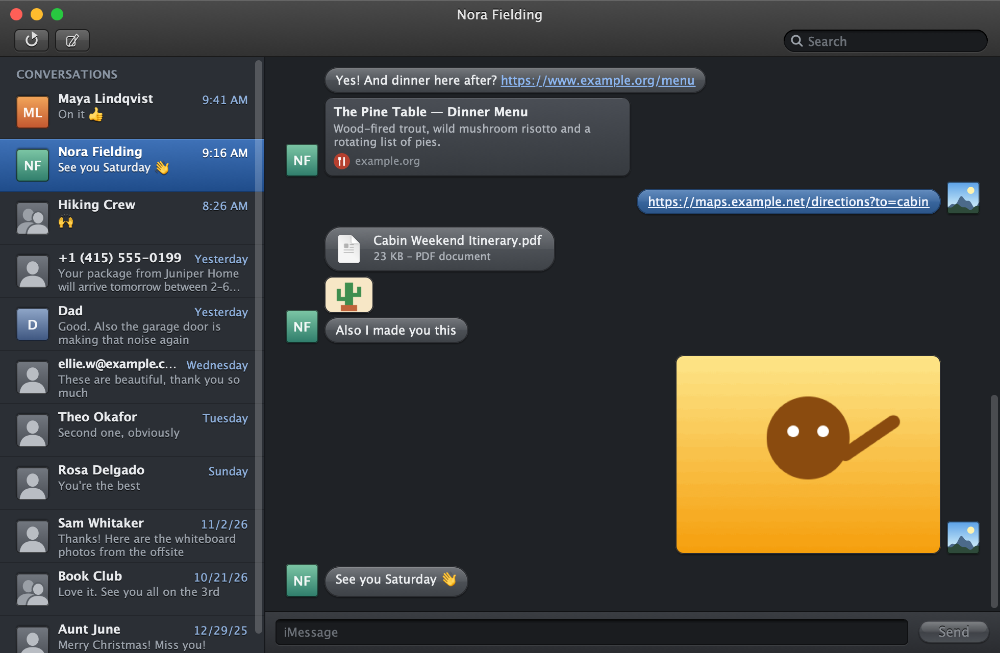

# Lion Messages


A personal macOS Messages client dressed as a Mac OS X Lion (10.7) app: Lucida Grande,
a brushed-gray unified toolbar, a Finder-style source list, glossy iChat bubbles, a sunken
Aqua composer, and a graphite dark mode.

It reads your local Messages database read-only and sends through Messages.app. Nothing
leaves your Mac: there is no server, no analytics, and no network access.




Screenshots show the built-in demo data, not real conversations.

## Features

- Conversation list and message history from `~/Library/Messages/chat.db` (opened read-only)
- Decodes message bodies stored in `attributedBody`
- Contact names and iChat-style buddy pictures from Contacts (View ▸ Show Buddy Pictures)
- Live updates when the database changes
- Sending through Messages.app via AppleScript
- Inline images, video thumbnails, file bubbles, clickable links, and link preview cards
  built from the preview data Messages already stored (never fetched from the network)
- Lion-style animations; respects Reduce Motion

## Requirements

- macOS 13 or later (built and tested on macOS 27 with Xcode 27 / Swift 6.4)
- Lucida Grande and Menlo, which ship with macOS

## Build and run

```sh
scripts/build-app.sh          # builds build/Lion Messages.app (release)
open "build/Lion Messages.app"
```

The script signs with your first code-signing identity if you have one, so permission
grants survive rebuilds; otherwise it signs ad hoc.

To try it without touching your messages, run the demo data:

```sh
swift run LionMessages --demo
swift run LionMessages --demo --appearance dark
```

## Permissions

| Permission | Why | Where |
| --- | --- | --- |
| Full Disk Access | Read `chat.db` and attachments | System Settings ▸ Privacy & Security ▸ Full Disk Access |
| Contacts | Names and pictures instead of phone numbers | Prompted on first launch |
| Automation (Messages) | Send messages | Prompted on first send |

## Tests

```sh
swift test
```

Tests use synthetic databases and never read your messages. An opt-in check against your
real database prints counts and timings only:

```sh
LION_REAL_DB_SMOKE=1 swift test --filter RealDatabaseSmokeTests
```

## Known limits

- The same person can appear as several conversations (SMS, RCS and iMessage chats are not merged)
- Shows the most recent 300 messages per conversation
- No reactions, typing indicators, or read receipts
- Attachments that are not downloaded to this Mac show a placeholder
- Starting a new conversation is not implemented; reply in existing ones

## Layout

- `Sources/MessagesModel` — shared models and the `MessagesService` protocol
- `Sources/MessagesData` — SQLite reader, decoders, Contacts, file watcher, AppleScript sender
- `Sources/LionMessages` — the AppKit/SwiftUI app and the Lion theme
- `scripts/` — app bundling and icon generation

Not affiliated with Apple. "Messages", "iChat" and "Mac OS X Lion" are Apple trademarks.
